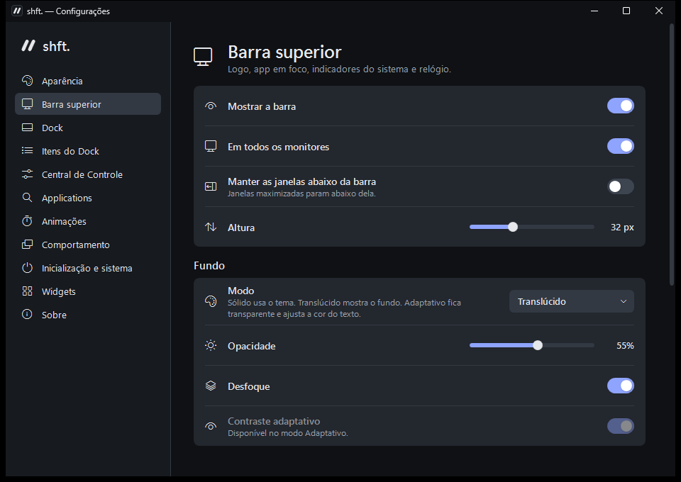

<p align="center">
  
  
</p>

<p align="center">A minimal desktop customization experience for Windows.</p>

shft. brings a top bar, a dock, a control center and an app launcher together in a single native app. It is written in C# and WPF, with no web view, and talks directly to Windows.




## Features

- **Top bar:** logo, focused app and its classic menus, memory, system tray icons, Bluetooth, network, volume, notifications and clock, on every monitor.
- **Three bar styles:** solid, translucent, or adaptive, where each end of the bar picks light or dark text from what is behind it.
- **Control Center:** network, Bluetooth, media, dark mode, HDR, night light, per-monitor brightness over DDC/CI, volume and microphone with device selection.
- **Applications:** a Spotlight-style search over every Windows app, Store apps included, driven from the keyboard, with favourites and recents. A tap of the Windows key opens it; shortcuts such as Win+E still work.
- **Dock:** magnification, running apps, folders, badges and 13 live widgets.
- **Light on resources:** about 80 MB of private memory and under 0.5% of one core at idle, measured with the dock and bar running.

The interface is in Brazilian Portuguese.

## Requirements

Windows 10 version 2004 (build 19041) or later, 64-bit. The installer includes the .NET runtime.

## Installation

Download `shft.-Setup-<version>.exe` from [Releases](https://github.com/rodolfoxm/shft/releases/latest). It installs for your user, without administrator rights. A portable `.zip` is available there too.

**The builds are not code-signed.** Windows SmartScreen may show "Windows protected your PC": choose **More info**, then **Run anyway**. `SHA256SUMS.txt` in each release lets you verify the download.

Updating keeps your preferences, which live in `%APPDATA%\shft`. Uninstalling asks before deleting them, and restores the Windows taskbar.

| Command | Effect |
|---|---|
| `shft.exe --quit` | Quits cleanly, restoring the taskbar and reserved screen space |
| `shft.exe --toggle-apps` | Opens or closes Applications |
| `shft.exe --toggle-controls` | Opens or closes the Control Center |

## Building

You need the .NET 8 SDK. For the installer, also [Inno Setup 6](https://jrsoftware.org/isinfo.php).

```powershell
dotnet build shft.csproj
dotnet test tests/shft.Tests
./scripts/build-release.ps1   # installer, portable zip and checksums in artifacts/
```

`scripts/make-branding.ps1` regenerates every logo and icon from one geometry. Pushing a tag such as `v1.0.1` that matches the version in `shft.csproj` builds and publishes a release through GitHub Actions.

Project documentation, in Portuguese: [architecture](docs/architecture.md), [design](docs/design.md), [quality](docs/quality.md).

## Credits

Built with [.NET](https://dotnet.microsoft.com), WPF, [Microsoft.Data.Sqlite](https://github.com/dotnet/efcore), [Inno Setup](https://jrsoftware.org/isinfo.php), [xUnit](https://xunit.net) and Segoe Fluent Icons. Weather by [Open-Meteo](https://open-meteo.com).

The experience draws on [Seelen UI](https://github.com/eythaann/Seelen-UI) and PrimoDock as references; no code from them is included. See [third-party notices](THIRD-PARTY-NOTICES.md).

## License

[PolyForm Noncommercial 1.0.0](LICENSE.md).
